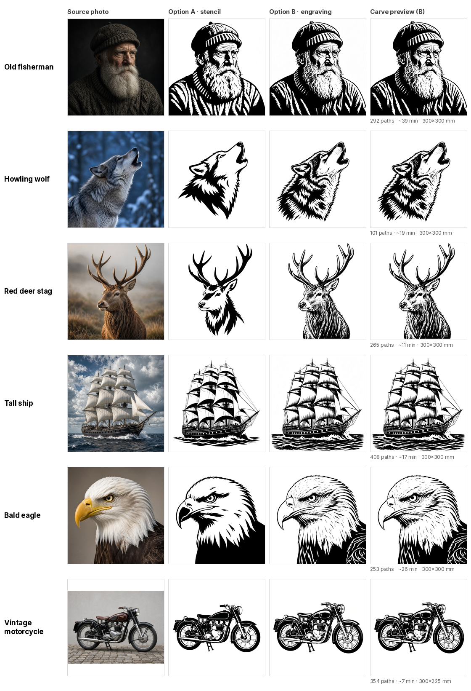

# photo-to-cnc-svg: an agent skill pack for photo → CNC-ready SVG

**A skill pack for LLM agents** (Grok Bot, Claude, ChatGPT-style and other tool-using agents). It turns a photo into carve-ready CNC art: bold black-and-white artwork, then a clean, mm-scaled SVG with a true-to-cut preview, a machining time estimate and import notes for your CAM program.

> **For humans:** you don't run this yourself. Point your AI agent at this repo (for example *"install the skill from github.com/SnazzyGaz/photo-to-cnc-svg"*), then just send it a photo plus a line of direction, like *"the fox's head, lose the grass"*. It shows you two artwork options, you pick one, and it hands back the SVG.

<table>
<tr><th width="25%">Source</th><th width="25%">B/W art</th><th width="25%">Traced SVG (cut map)</th><th width="25%">Carved, in Carve Sim</th></tr>
<tr>
<td></td>
<td></td>
<td></td>
<td></td>
</tr>
<tr><td colspan="4"><sub><b>Samurai skull, inverted.</b> Drawn white on black and traced with <code>--invert</code>, so the light parts are cut. Filled with white epoxy in walnut it reads as a pale image on a dark board. 380 paths, about 16 min.</sub></td></tr>
<tr>
<td></td>
<td></td>
<td></td>
<td></td>
</tr>
<tr><td colspan="4"><sub><b>Regal stag, standard.</b> Black lines are cut. Shown in ash with a walnut inlay. 326 paths, about 11 min.</sub></td></tr>
</table>

<sub>V-carve, 300 mm, 60° V-bit, 3 mm deep. The source images are generated stand-ins.</sub>

## Works with Carve Sim

The SVGs this skill makes can be previewed in [Carve Sim](https://github.com/SnazzyGaz/carve-sim), a free browser app that shows the carve in 3D in different woods and fills (epoxy, metallic or wood inlay), sanded flush or as poured. Drop the SVG in and it reads the size and carve type from the file. **[Open Carve Sim →](https://snazzygaz.github.io/carve-sim/)**

<p align="center"></p>
<p align="center"><sub>The samurai skull SVG in Carve Sim · black walnut · elm inlay, sanded flush</sub></p>

## For agents: start here

**Entry point:** [`skills/photo-to-cnc-svg/SKILL.md`](skills/photo-to-cnc-svg/SKILL.md). Load it, plus the two stage skills it references:
[`skills/cnc-graphic-artwork-generator/SKILL.md`](skills/cnc-graphic-artwork-generator/SKILL.md) (photo → B/W artwork) and
[`skills/image-to-cnc-cut-svg/SKILL.md`](skills/image-to-cnc-cut-svg/SKILL.md) (artwork → SVG).

**You need:**
- an image-generation tool that accepts a reference image
- a shell with Python 3, this repo checked out, and `pip install -r requirements.txt`

**Flow:**
1. Take the user's photo and short direction (subject/region, what to keep or drop). If the subject is obvious, don't ask questions.
2. Generate **option A** (simplified bold stencil, one pass) and **option B** (mid-ground engraving: an engraving pass, then a moderate firming pass using pass 1 as reference; if that barely changes anything, a third "bold linocut" pass using only the pass-2 image as reference). Prompt templates are [below](#image-generation-prompt-templates).
3. Show A and B side by side; let the user pick one or ask for a tweak.
4. Trace the pick: `python3 scripts/cnc_vector.py art.png -o <subject>_vcarve_300mm.svg --mode vcarve --width-mm 300 --vbit-angle 60 --depth 3 --threshold 128 --smooth 0.8 --min-feature 0.5 > stats.json` (defaults unless the user gives specs; `--min-feature 0.8` for option A).
5. Render `python3 scripts/preview.py <svg> preview.png`, look at it, and re-trace with a higher/lower `--min-feature` if it is speckled or has lost detail (1 to 3 tries).

**Return to the user:** the SVG file, the preview PNG, and a short note covering size (mm), mode, path count, the time estimate range from `stats.json` (rough; CAM simulation is authoritative), whether wide areas need a clearance end mill, and the one-line import tip for their CAM program ([CAM notes](#importing-into-cam)).

## The flow

| Source photo | Option A: bold stencil | Option B: mid-ground engraving | Traced SVG (preview) |
|---|---|---|---|
|  |  |  |  |

1. **Photo + short direction.** e.g. "the fox's head and ruff, lose the grass".
2. **Two artwork options** are generated from the photo:
   - **A, simplified bold stencil:** big solid black shapes, white negative space, smooth contours, few internal lines. Quick to carve, reads from across a room.
   - **B, mid-ground engraving:** made in two passes: a faithful **engraving pass** (woodcut-style hatching that follows the form), then a **moderate firming pass** that thickens strokes, removes grey/stipple and deepens the darkest shadows into solid black. Image models often copy pass 1 too faithfully, so if pass 2 looks almost unchanged, a **third pass** (pass 2 as the only reference, "convert to a bold linocut relief print") does the firming. It sits between a fine engraving and a bold linocut: lots of character, still traceable.
3. **Pick one** (or ask for a tweak).
4. **Trace to SVG** with `cnc_vector.py` (defaults below unless you give specs).
5. **Deliver** the SVG, an even-odd preview PNG of exactly what gets carved, and short carve notes: size, path count, time estimate, whether wide areas need a clearance end mill, and how to import it.

## Example gallery

All examples are original: the "photos" are generated stand-ins, then run through the real flow at the default settings. Every subject has option A and B traced so you can compare them; B (the engraving) is the house style.



| Subject | Source | Option A | Option B | Traced | SVG | Paths | Est. time* |
|---|---|---|---|---|---|---|---|
| Old fisherman |  |  |  | B: <br>A:  | [B](examples/old-fisherman/old-fisherman_vcarve_300mm.svg) · [A](examples/old-fisherman/old-fisherman-stencil_vcarve_300mm.svg) | B 292 · A 112 | B ~39 min (27–51) · A ~33 min (23–42) |
| Howling wolf |  |  |  | B: <br>A:  | [B](examples/howling-wolf/howling-wolf_vcarve_300mm.svg) · [A](examples/howling-wolf/howling-wolf-stencil_vcarve_300mm.svg) | B 101 · A 12 | B ~19 min (14–25) · A ~12 min (9–16) |
| Red deer stag |  |  |  | B: <br>A:  | [B](examples/red-deer-stag/red-deer-stag_vcarve_300mm.svg) · [A](examples/red-deer-stag/red-deer-stag-stencil_vcarve_300mm.svg) | B 265 · A 7 | B ~11 min (7–14) · A ~13 min (9–16) |
| Tall ship |  |  |  | B: <br>A:  | [B](examples/tall-ship/tall-ship_vcarve_300mm.svg) · [A](examples/tall-ship/tall-ship-stencil_vcarve_300mm.svg) | B 408 · A 144 | B ~17 min (12–22) · A ~25 min (17–32) |
| Bald eagle |  |  |  | B: <br>A:  | [B](examples/bald-eagle/bald-eagle_vcarve_300mm.svg) · [A](examples/bald-eagle/bald-eagle-stencil_vcarve_300mm.svg) | B 253 · A 18 | B ~26 min (18–34) · A ~24 min (17–32) |
| Vintage motorcycle (300×225 mm) |  |  |  | B: <br>A:  | [B](examples/vintage-motorcycle/vintage-motorcycle_vcarve_300mm.svg) · [A](examples/vintage-motorcycle/vintage-motorcycle-stencil_vcarve_300mm.svg) | B 354 · A 105 | B ~7 min (5–10) · A ~18 min (13–24) |
| Red fox |  |  |  | B: <br>A:  | [B](examples/red-fox/red-fox_vcarve_300mm.svg) · [A](examples/red-fox/red-fox-stencil_vcarve_300mm.svg) | B 1099 · A 20 | B ~35 min (25–45) · A ~18 min (13–24) |
| Lighthouse |  |  |  | A:  | [A](examples/lighthouse/lighthouse_vcarve_300mm.svg) | 87 | ~32 min (22–41) |

\* V-carve, 300 mm wide, 60° V-bit, 3 mm max depth, feeds 1200/300/3000 mm/min. Rough estimate from the script; your CAM simulation is authoritative. Each folder also has the script's `stats.json`.

Notes: the old fisherman, bald eagle, tall ship and vintage motorcycle needed the third (bold linocut) pass; the stag and wolf firmed up at pass 2. The tall ship's thin rigging lines will carve shallow at 300 mm, so it suits 450 mm+ or a 30° bit. The lighthouse was traced as A only: its B kept fine stipple and sky hatching, which is beautiful on paper but slow and fragile in wood.

## Installing the skills in your agent

The `skills/` folder holds three plain-Markdown skills with YAML front matter (`name`, `description`):

| Skill | Does |
|---|---|
| `skills/photo-to-cnc-svg/SKILL.md` | The end-to-end flow above (start here) |
| `skills/cnc-graphic-artwork-generator/SKILL.md` | Stage 1: photo → B/W artwork, prompt rules and QC |
| `skills/image-to-cnc-cut-svg/SKILL.md` | Stage 2: artwork → SVG, settings, preview, CAM notes |

- **Grok Bot and similar agents with a skills folder:** drop the three folders into the agent's skills directory and put this repo (or at least `scripts/` and `requirements.txt`) on the machine the agent runs code on. The skills refer to `scripts/cnc_vector.py` relative to the repo root.
- **Claude (Agent Skills / Claude Code):** copy each folder into `.claude/skills/` (project) or `~/.claude/skills/` (personal), and keep the repo checked out alongside.
- **ChatGPT / custom GPTs and other chat assistants:** paste `skills/photo-to-cnc-svg/SKILL.md` (and the stage 1 skill) into the instructions, and attach `cnc_vector.py` + `preview.py` as files for the code tool. The image-generation steps need a model that accepts a reference image.

The agent needs: an image-generation tool that takes a reference image, and somewhere to run Python.

## Image-generation prompt templates

Replace the `[...]` parts. Always attach the source photo as a reference image. Naming the subject's defining features is what keeps it from drifting into generic clip art.

### Option A: simplified bold stencil (one generation, photo as reference)

```
Simplified bold stencil of THIS exact [subject] from the reference photo: same
[pose / view] and framing, tightly cropped to [region, e.g. head and shoulders],
no background. Bold clean graphic made of large solid black shapes and pure
white negative space, smooth contours, few internal lines. Keep what makes it
this [subject]: [defining features, e.g. ear shape, eye, nose, markings, props],
[fur / hair / feathers] shown as a handful of bold locks. Pure black on pure
white only, no grey, no gradients, no speckles, no text, crisp edges, high
resolution, looks like finished vector stencil artwork.
```

### Option B, pass 1: faithful engraving (photo as reference)

```
Faithful black-and-white woodcut / engraved-illustration interpretation of THIS
exact [subject] from the reference photo, same [pose / view] and framing,
tightly cropped to [region], background removed to plain white. Name and keep:
[defining features and anything physically on the subject, e.g. collar, bridle].
Render form with directional hatching that follows the [fur / muscle / feather]
flow, dense blacks in shadows, open white on lit planes. Pure black on pure
white only, no grey, no gradients, no text, crisp edges, high resolution.
```

### Option B, pass 2: moderate firming (pass 1 + photo as references)

```
Moderate refinement of the engraved [subject] (first reference) using the photo
(second reference) for fidelity. Keep the exact same pose, framing, anatomy and
most of the hatching, but turn all grey or stippled tones into clean black
strokes, make every stroke slightly thicker, deepen the darkest shadows
([where, e.g. under the jaw, inner ear]) into some solid black, and add a clear
contour line on the outer edge. Not a full bold linocut: it should sit between a
fine engraving and a bold linocut. Pure black on pure white only, no grey, no
gradients, no speckles, no text, plain white background, crisp edges, high
resolution.
```

### Option B, pass 3 (only if pass 2 barely changed): bold linocut (pass 2 as the ONLY reference)

```
Convert this engraving of [subject] into a bold black-and-white linocut relief
print with chunky gouge marks, keeping the exact same [pose / face / features].
[Dark areas, e.g. cap, sweater, body feathers, tyres] become solid black masses
with only a few thick white carved cuts. Lit planes stay clean white with a few
decisive strokes. [Hair / fur / beard / feathers] as fewer, long thick locks
separated by black gouge strokes, no fine wiry hairs. Minimum line width like a
2-3 mm gouge cut; nothing hair-thin, no texture, no dots. Pure black and pure
white, no grey, white background, crisp edges, high resolution.
```

Tips: for scenes (buildings, landscapes) ask for "a few bold horizontal engraved cloud lines with plenty of white" instead of a fully hatched sky. If pass 2 barely changes pass 1 (common: the model copies the first reference closely), don't keep re-running it; use pass 3 below.

## Importing into CAM

- **Vectric (VCarve / Aspire):** import the SVG at 1:1 in mm, select all, V-Carve toolpath with your V-bit; tick flat depth and add the end mill as clearance tool for wide areas.
- **Carbide Create:** import the SVG, check the size, Advanced V-carve with the end mill as the pocket tool.
- **Easel:** import the SVG and check the width (it can mis-scale). Easel has no true V-carve, so fill-cut/pocket with an end mill, or use other CAM for V-carving.
- **Fusion 360:** insert the SVG onto a sketch, verify scale, then use an Engrave (V-bit) or 2D Pocket toolpath.

If the script notes say *"flat areas wider than 3.5 mm hit max depth"*, that is the 60° bit bottoming out at 3 mm: use flat-depth V-carving with a clearance end mill.

## Reference: the tracing script (used by the agent)

The agent runs these; they are documented here for agents, and for anyone curious.

### Install

Python 3.9+.

```bash
git clone https://github.com/SnazzyGaz/photo-to-cnc-svg.git
cd photo-to-cnc-svg
pip install -r requirements.txt
```

Dependencies: numpy, scipy, opencv-python-headless, scikit-image, potracer (pure-Python potrace), cairosvg (previews; needs the Cairo library, which macOS gets via `brew install cairo` and Debian/Ubuntu via `apt install libcairo2`).

### Usage

```bash
# Generated B/W artwork (option A or B) -> V-carve SVG, 300 mm wide, with job estimate
python3 scripts/cnc_vector.py art.png -o fox_vcarve_300mm.svg \
  --mode vcarve --width-mm 300 --vbit-angle 60 --depth 3 \
  --threshold 128 --smooth 0.8 --min-feature 0.5 > stats.json

# True-to-cut preview (all paths merged, even-odd, so holes read correctly)
python3 scripts/preview.py fox_vcarve_300mm.svg preview.png --width 1600
```

The SVG is in millimetres (`width="300mm"` with a matching viewBox), so it imports at 1:1. The JSON on stdout has size, path/node counts and, when `--depth` is given, a time estimate with range and notes.

### Modes

| Mode | What you get | Typical use |
|---|---|---|
| `vcarve` | Closed filled regions, cleaned to what the V-bit can resolve | Portraits, line art, engravings (recommended) |
| `pocket` | Closed regions constrained to the end-mill diameter; `--levels N` for stepped depths | Signs, relief-style layering |
| `engrave` | Single-line centrelines (open paths, smoothed) | Fine line engraving, drag/pen tools |
| `profile` | Outer silhouette only | Cutting the shape free |

### Flags

| Flag | Default | Meaning |
|---|---|---|
| `--mode` | (required) | `vcarve`, `pocket`, `engrave`, `profile` |
| `--width-mm` / `--height-mm` | | Finished size (give one; aspect is kept) |
| `--threshold` | `auto` | `auto`, `adaptive`, or 0–255. Use `128` for clean B/W art |
| `--smooth` | `2.0` | Denoise strength 0–5. Use `0.8` for clean art, higher for photos |
| `--min-feature` | per mode | Smallest kept detail in mm. Raise if speckled, lower if detail is lost |
| `--tool-dia` | `3.175` | End mill / profile tool diameter (mm) |
| `--vbit-angle` | `60` | V-bit included angle |
| `--depth` | | Total cut depth (V-carve: max/flat depth). Enables the estimate |
| `--pass-depth` | tool/2 | Depth per pass (V-carve: = depth) |
| `--feed` / `--plunge` / `--rapid` | 1200 / 300 / 3000 | mm/min, for the estimate |
| `--safe-z` / `--stepover` | 5 / 0.4 | Estimate inputs |
| `--crop x0,y0,x1,y1` | | Crop in px or 0–1 fractions |
| `--isolate` | | GrabCut the subject inside `--crop` (photos) |
| `--use-isolation-as-mask` | | Profile: silhouette = isolated subject |
| `--invert` | | Cut the light areas instead of the dark |
| `--levels` | `1` | Pocket depth levels |
| `--lines dark\|edges` | `dark` | Engrave source |
| `--single` | | Profile: keep the largest outline only |
| `--border` | `0` | Add a rectangular profile border, margin in mm |
| `--alphamax` / `--opttol` | 1.1 / 0.4 | Potrace corner smoothness / curve simplification |
| `--preview` | | Quick built-in PNG (fills paths separately; prefer `preview.py`) |

Run `python3 scripts/cnc_vector.py --help` for the full list.

### Defaults used by the skills

| Setting | Default |
|---|---|
| Style | V-carve |
| Width | 300 mm |
| V-bit | 60° |
| Depth | 3 mm (pocket 6, engrave 1, profile = stock thickness) |
| End mill (clearance / pocket) | 3.175 mm (1/8") |
| Feeds | 1200 feed / 300 plunge / 3000 rapid mm/min |
| Trace settings, generated art | `--threshold 128 --smooth 0.8 --min-feature 0.5` (0.8 for option A or a 90° bit) |
| Trace settings, photo | `--threshold auto --smooth 2`, plus `--crop`/`--isolate` as needed |

## Repo layout

```
AGENTS.md                 short agent entry point (mirrors "For agents")
scripts/cnc_vector.py     tracer (vcarve / pocket / engrave / profile) + job estimate
scripts/preview.py        even-odd merged preview PNG
skills/                   the three assistant skills
examples/<subject>/       source.jpg, option-a.jpg, option-b.jpg,
                          <subject>_vcarve_300mm.svg (B), preview.png, stats.json,
                          <subject>-stencil_vcarve_300mm.svg (A), preview-option-a.png,
                          stats-option-a.json
docs/contact-sheet.png    overview of the example subjects
```

## Licence

MIT © 2026 Garyck Arntzen ([@_mintydoge](https://x.com/_mintydoge)). See [LICENSE](LICENSE).
