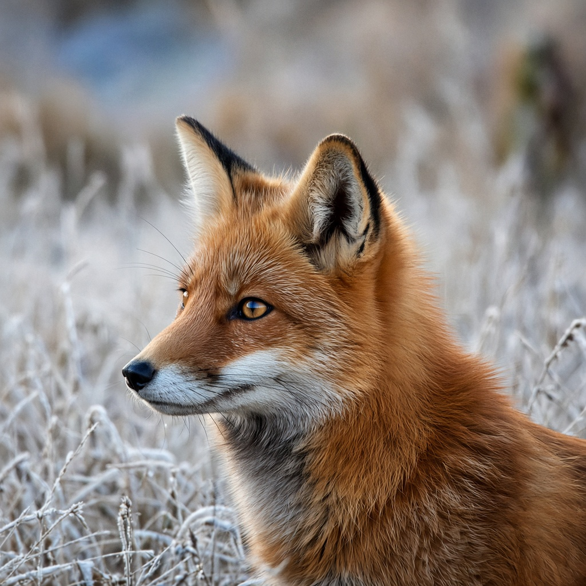
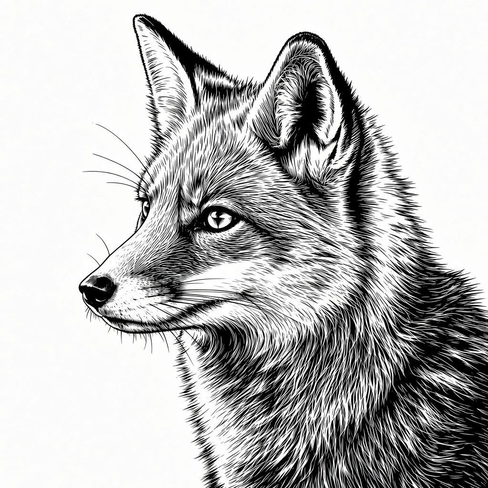
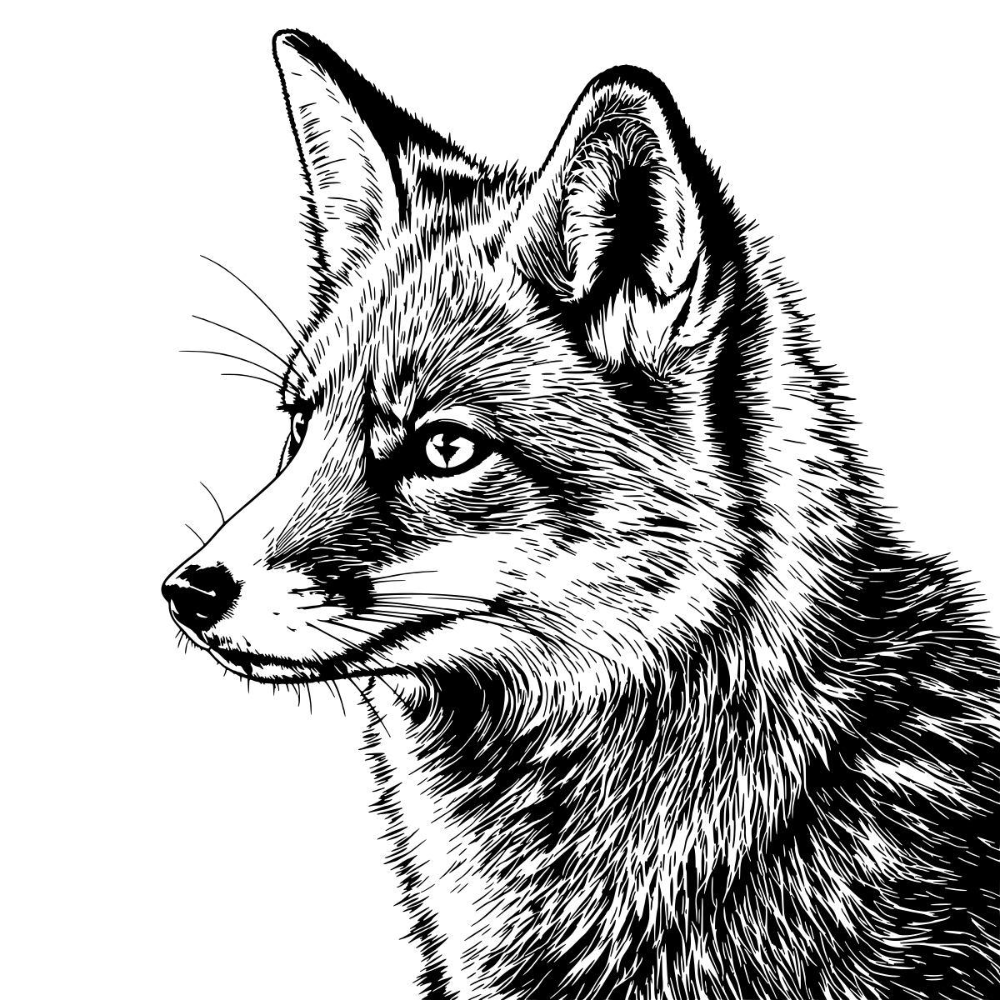
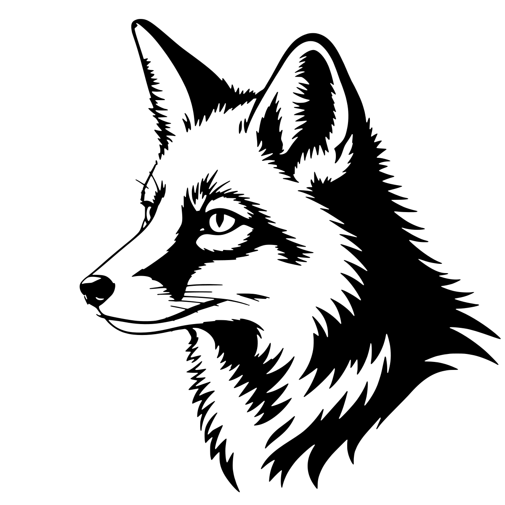
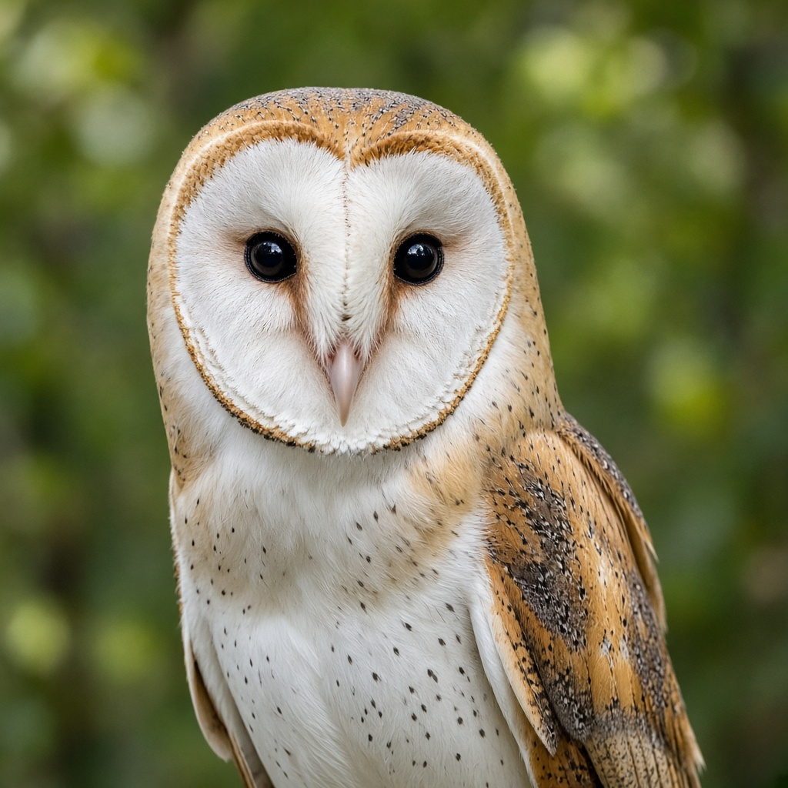
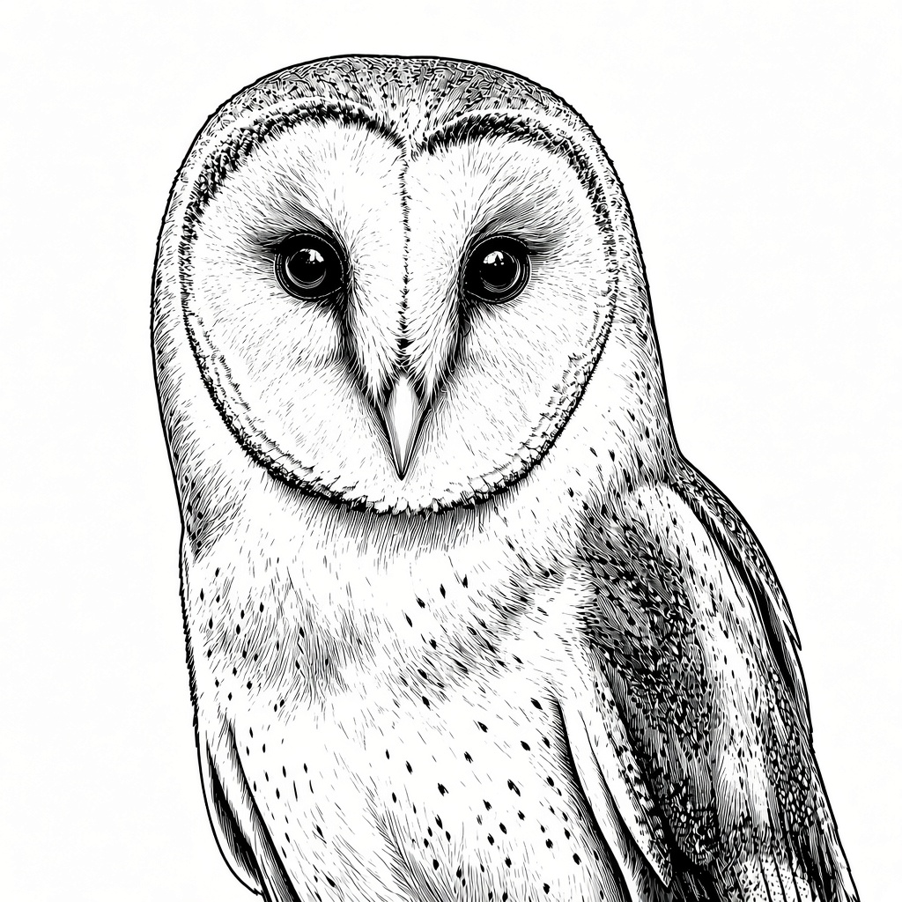
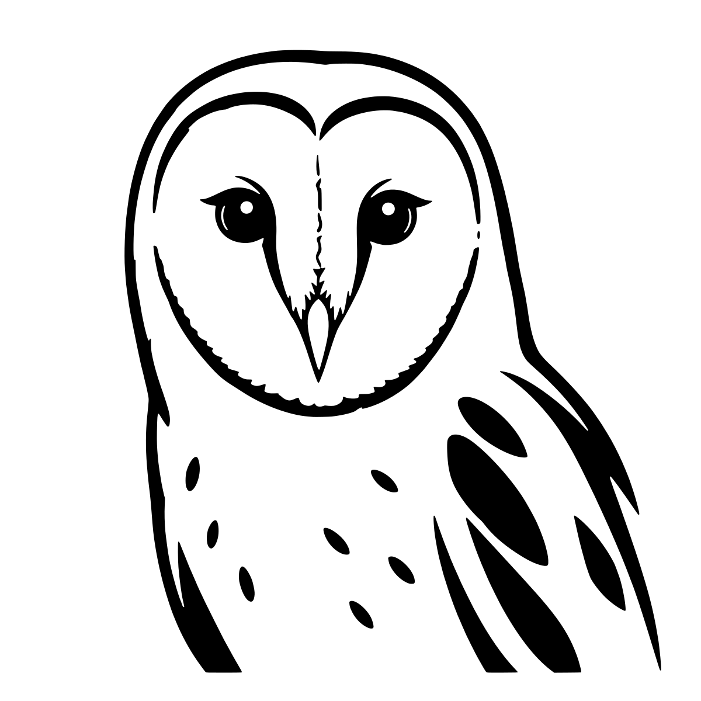
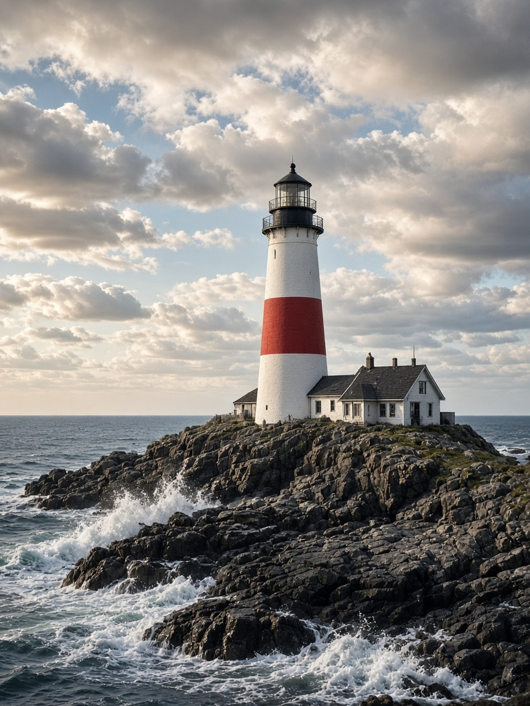
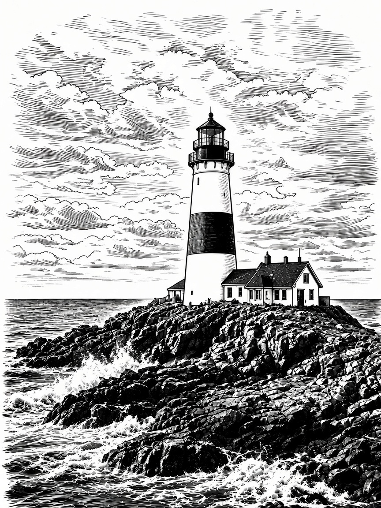
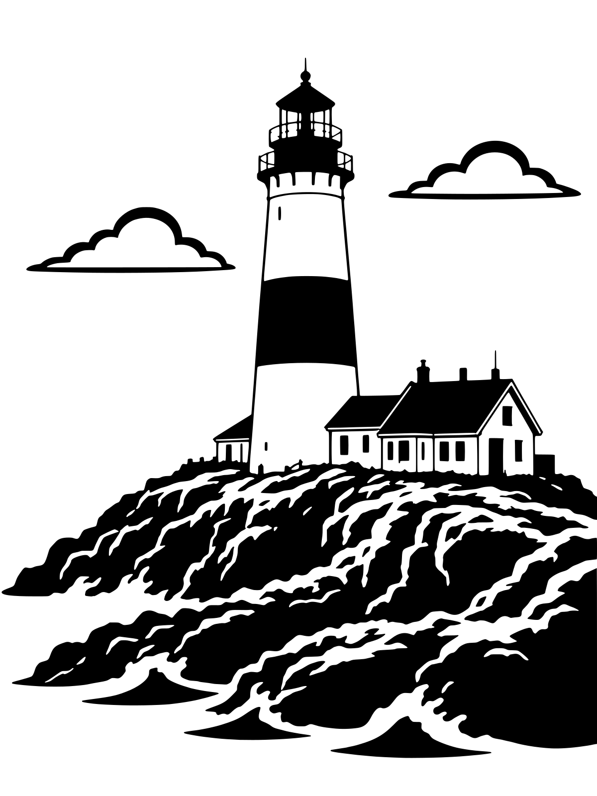

# photo-to-cnc-svg

Turn a photo into carve-ready CNC art: **photo → black-and-white artwork → clean, mm-scaled SVG** with a true-to-cut preview, a machining time estimate and import notes for your CAM program.

It is two things in one repo:

- **A tracing tool** (`scripts/cnc_vector.py`) that turns any black-and-white image (or a photo) into closed, tool-aware vector regions for V-carve, pocket, engrave or profile cutting.
- **A set of AI-assistant skills** (`skills/`) that run the whole flow, including the image-generation step that turns a photo into artwork worth carving.

| Source photo | Option A: bold stencil | Option B: mid-ground engraving | Traced SVG (preview) |
|---|---|---|---|
|  |  |  |  |

## The flow

1. **Photo + short direction.** e.g. "the fox's head and ruff, lose the grass".
2. **Two artwork options** are generated from the photo:
   - **A, simplified bold stencil:** big solid black shapes, white negative space, smooth contours, few internal lines. Quick to carve, reads from across a room.
   - **B, mid-ground engraving:** made in two passes: a faithful **engraving pass** (woodcut-style hatching that follows the form), then a **moderate firming pass** that thickens strokes, removes grey/stipple and deepens the darkest shadows into solid black. It sits between a fine engraving and a bold linocut: lots of character, still traceable.
3. **Pick one** (or ask for a tweak).
4. **Trace to SVG** with `cnc_vector.py` (defaults below unless you give specs).
5. **Deliver** the SVG, an even-odd preview PNG of exactly what gets carved, and short carve notes: size, path count, time estimate, whether wide areas need a clearance end mill, and how to import it.

## Example gallery

All examples are original: the "photos" are generated stand-ins, then run through the real flow at the default settings.

| Subject | Source | Option A | Option B | Traced | SVG | Paths | Est. time* |
|---|---|---|---|---|---|---|---|
| Red fox |  |  |  | B: <br>A:  | [B](examples/red-fox/red-fox_vcarve_300mm.svg) · [A](examples/red-fox/red-fox-stencil_vcarve_300mm.svg) | B 1099 · A 20 | B ~35 min (25–45) · A ~18 min (13–24) |
| Barn owl |  |  |  | A:  | [A](examples/barn-owl/barn-owl_vcarve_300mm.svg) | 27 | ~13 min (9–16) |
| Lighthouse |  |  |  | A:  | [A](examples/lighthouse/lighthouse_vcarve_300mm.svg) | 87 | ~32 min (22–41) |

\* V-carve, 300 mm wide, 60° V-bit, 3 mm max depth, feeds 1200/300/3000 mm/min. Rough estimate from the script; your CAM simulation is authoritative. Each folder also has the script's `stats.json`.

Why some were traced as A: the owl's and lighthouse's option B kept a lot of fine stipple and sky hatching, which is beautiful on paper but slow and fragile in wood. Very fine engravings are better carved large (450 mm+) or as option A. The fox's B has stroke-shaped hatching that traces cleanly.

## Install

Python 3.9+.

```bash
git clone https://github.com/SnazzyGaz/photo-to-cnc-svg.git
cd photo-to-cnc-svg
pip install -r requirements.txt
```

Dependencies: numpy, scipy, opencv-python-headless, scikit-image, potracer (pure-Python potrace), cairosvg (previews; needs the Cairo library, which macOS gets via `brew install cairo` and Debian/Ubuntu via `apt install libcairo2`).

## Tracing: `scripts/cnc_vector.py`

```bash
# Generated B/W artwork (option A or B) -> V-carve SVG, 300 mm wide, with job estimate
python3 scripts/cnc_vector.py art.png -o fox_vcarve_300mm.svg \
  --mode vcarve --width-mm 300 --vbit-angle 60 --depth 3 \
  --threshold 128 --smooth 0.8 --min-feature 0.5 > stats.json

# True-to-cut preview (all paths merged, even-odd, so holes read correctly)
python3 scripts/preview.py fox_vcarve_300mm.svg preview.png --width 1600
```

The SVG is in millimetres (`width="300mm"` with a matching viewBox), so it imports at 1:1. The JSON on stdout has size, path/node counts and, when `--depth` is given, a time estimate with range and notes.

### Modes

| Mode | What you get | Typical use |
|---|---|---|
| `vcarve` | Closed filled regions, cleaned to what the V-bit can resolve | Portraits, line art, engravings (recommended) |
| `pocket` | Closed regions constrained to the end-mill diameter; `--levels N` for stepped depths | Signs, relief-style layering |
| `engrave` | Single-line centrelines (open paths, smoothed) | Fine line engraving, drag/pen tools |
| `profile` | Outer silhouette only | Cutting the shape free |

### Flags

| Flag | Default | Meaning |
|---|---|---|
| `--mode` | (required) | `vcarve`, `pocket`, `engrave`, `profile` |
| `--width-mm` / `--height-mm` | | Finished size (give one; aspect is kept) |
| `--threshold` | `auto` | `auto`, `adaptive`, or 0–255. Use `128` for clean B/W art |
| `--smooth` | `2.0` | Denoise strength 0–5. Use `0.8` for clean art, higher for photos |
| `--min-feature` | per mode | Smallest kept detail in mm. Raise if speckled, lower if detail is lost |
| `--tool-dia` | `3.175` | End mill / profile tool diameter (mm) |
| `--vbit-angle` | `60` | V-bit included angle |
| `--depth` | | Total cut depth (V-carve: max/flat depth). Enables the estimate |
| `--pass-depth` | tool/2 | Depth per pass (V-carve: = depth) |
| `--feed` / `--plunge` / `--rapid` | 1200 / 300 / 3000 | mm/min, for the estimate |
| `--safe-z` / `--stepover` | 5 / 0.4 | Estimate inputs |
| `--crop x0,y0,x1,y1` | | Crop in px or 0–1 fractions |
| `--isolate` | | GrabCut the subject inside `--crop` (photos) |
| `--use-isolation-as-mask` | | Profile: silhouette = isolated subject |
| `--invert` | | Cut the light areas instead of the dark |
| `--levels` | `1` | Pocket depth levels |
| `--lines dark\|edges` | `dark` | Engrave source |
| `--single` | | Profile: keep the largest outline only |
| `--border` | `0` | Add a rectangular profile border, margin in mm |
| `--alphamax` / `--opttol` | 1.1 / 0.4 | Potrace corner smoothness / curve simplification |
| `--preview` | | Quick built-in PNG (fills paths separately; prefer `preview.py`) |

Run `python3 scripts/cnc_vector.py --help` for the full list.

### Defaults used by the skills

| Setting | Default |
|---|---|
| Style | V-carve |
| Width | 300 mm |
| V-bit | 60° |
| Depth | 3 mm (pocket 6, engrave 1, profile = stock thickness) |
| End mill (clearance / pocket) | 3.175 mm (1/8") |
| Feeds | 1200 feed / 300 plunge / 3000 rapid mm/min |
| Trace settings, generated art | `--threshold 128 --smooth 0.8 --min-feature 0.5` (0.8 for option A or a 90° bit) |
| Trace settings, photo | `--threshold auto --smooth 2`, plus `--crop`/`--isolate` as needed |

## Importing into CAM

- **Vectric (VCarve / Aspire):** import the SVG at 1:1 in mm, select all, V-Carve toolpath with your V-bit; tick flat depth and add the end mill as clearance tool for wide areas.
- **Carbide Create:** import the SVG, check the size, Advanced V-carve with the end mill as the pocket tool.
- **Easel:** import the SVG and check the width (it can mis-scale). Easel has no true V-carve, so fill-cut/pocket with an end mill, or use other CAM for V-carving.
- **Fusion 360:** insert the SVG onto a sketch, verify scale, then use an Engrave (V-bit) or 2D Pocket toolpath.

If the script notes say *"flat areas wider than 3.5 mm hit max depth"*, that is the 60° bit bottoming out at 3 mm: use flat-depth V-carving with a clearance end mill.

## Using it as an AI-assistant skill

The `skills/` folder holds three plain-Markdown skills with YAML front matter (`name`, `description`):

| Skill | Does |
|---|---|
| `skills/photo-to-cnc-svg/SKILL.md` | The end-to-end flow above (start here) |
| `skills/cnc-graphic-artwork-generator/SKILL.md` | Stage 1: photo → B/W artwork, prompt rules and QC |
| `skills/image-to-cnc-cut-svg/SKILL.md` | Stage 2: artwork → SVG, settings, preview, CAM notes |

- **Grok Bot and similar agents with a skills folder:** drop the three folders into the agent's skills directory and put this repo (or at least `scripts/` and `requirements.txt`) on the machine the agent runs code on. The skills refer to `scripts/cnc_vector.py` relative to the repo root.
- **Claude (Agent Skills / Claude Code):** copy each folder into `.claude/skills/` (project) or `~/.claude/skills/` (personal), and keep the repo checked out alongside.
- **ChatGPT / custom GPTs and other chat assistants:** paste `skills/photo-to-cnc-svg/SKILL.md` (and the stage 1 skill) into the instructions, and attach `cnc_vector.py` + `preview.py` as files for the code tool. The image-generation steps need a model that accepts a reference image.

The agent needs: an image-generation tool that takes a reference image, and somewhere to run Python.

## Image-generation prompt templates

Replace the `[...]` parts. Always attach the source photo as a reference image. Naming the subject's defining features is what keeps it from drifting into generic clip art.

### Option A: simplified bold stencil (one generation, photo as reference)

```
Simplified bold stencil of THIS exact [subject] from the reference photo: same
[pose / view] and framing, tightly cropped to [region, e.g. head and shoulders],
no background. Bold clean graphic made of large solid black shapes and pure
white negative space, smooth contours, few internal lines. Keep what makes it
this [subject]: [defining features, e.g. ear shape, eye, nose, markings, props],
[fur / hair / feathers] shown as a handful of bold locks. Pure black on pure
white only, no grey, no gradients, no speckles, no text, crisp edges, high
resolution, looks like finished vector stencil artwork.
```

### Option B, pass 1: faithful engraving (photo as reference)

```
Faithful black-and-white woodcut / engraved-illustration interpretation of THIS
exact [subject] from the reference photo, same [pose / view] and framing,
tightly cropped to [region], background removed to plain white. Name and keep:
[defining features and anything physically on the subject, e.g. collar, bridle].
Render form with directional hatching that follows the [fur / muscle / feather]
flow, dense blacks in shadows, open white on lit planes. Pure black on pure
white only, no grey, no gradients, no text, crisp edges, high resolution.
```

### Option B, pass 2: moderate firming (pass 1 + photo as references)

```
Moderate refinement of the engraved [subject] (first reference) using the photo
(second reference) for fidelity. Keep the exact same pose, framing, anatomy and
most of the hatching, but turn all grey or stippled tones into clean black
strokes, make every stroke slightly thicker, deepen the darkest shadows
([where, e.g. under the jaw, inner ear]) into some solid black, and add a clear
contour line on the outer edge. Not a full bold linocut: it should sit between a
fine engraving and a bold linocut. Pure black on pure white only, no grey, no
gradients, no speckles, no text, plain white background, crisp edges, high
resolution.
```

Tips: for scenes (buildings, landscapes) ask for "a few bold horizontal engraved cloud lines with plenty of white" instead of a fully hatched sky. If pass 2 barely changes pass 1, run it again with stronger wording ("noticeably thicker strokes, merge shadows into solid black masses").

## Repo layout

```
scripts/cnc_vector.py     tracer (vcarve / pocket / engrave / profile) + job estimate
scripts/preview.py        even-odd merged preview PNG
skills/                   the three assistant skills
examples/<subject>/       source.jpg, option-a.jpg, option-b.jpg,
                          <subject>_vcarve_300mm.svg, preview.png, stats.json
```

## Licence

MIT © 2026 Garyck Arntzen. See [LICENSE](LICENSE).
